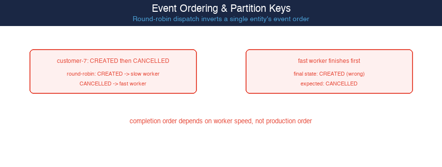
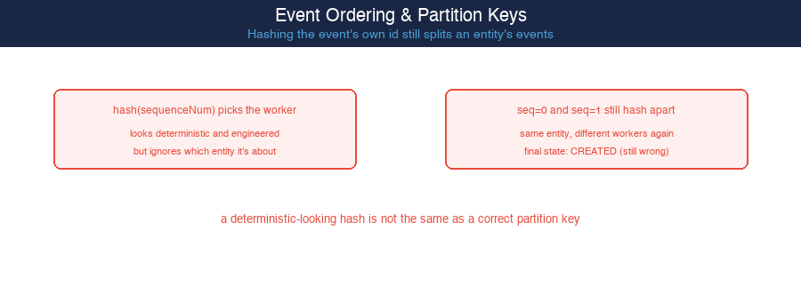
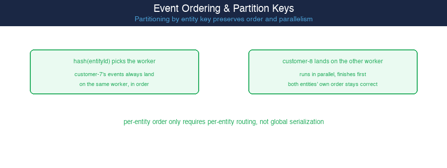

# Event Ordering & Partition Keys — Per-Entity Order Only Requires Per-Entity Routing

**Pattern:** Round-robin dispatch (a customer's CREATED event lands on a slow worker, its later CANCELLED event lands on a fast worker — the fast worker finishes first, final state ends up wrong) → hashing the event's own sequence number (looks deterministic, but still routes same-entity events to different workers, still wrong) → hashing the entity's own id as the partition key (every event for the same entity always lands on the same worker, in order, while different entities still process fully in parallel)

**Volume 24** (Event-Driven Architecture Patterns) — Paper 130.

---

## Read the Full Article on Medium

_Article coming soon on Medium._

---

## What This Paper Is About

A concurrently-processed event pipeline has no inherent relationship between the order events were produced in and the order they finish being processed — completion order depends on which worker an event landed on and how long that worker takes, not the event's original sequence number. Round-robin dispatch demonstrates this directly: a customer's CREATED event, dispatched to a slow worker, can finish after that same customer's later CANCELLED event, dispatched to a fast worker, leaving the final recorded state wrong (verified: final state CREATED instead of the correct CANCELLED). Replacing round-robin with a hash of the event's own sequence number looks like a fix but produces the identical failure, because it still has no relationship to which entity the event describes (verified: same wrong final state). The actual fix hashes the entity's id, not the event's — every event about the same entity always lands on the same worker and is processed in that worker's own FIFO order, while different entities still run fully in parallel on different workers (verified: both entities' per-entity order correct, with one entity finishing entirely before the other even starts its second event).

## The Pressure: Round-Robin Dispatch Inverts a Single Entity's Event Order

Round-robin dispatch distributes events evenly across workers with zero regard for which entity each event describes. When two events about the same entity happen to land on workers with different processing speeds, the faster worker can finish the later event before the slower worker finishes the earlier one — and whichever write lands last in the shared state store wins, regardless of which one actually happened first.

## The Principle

**Ordering is only ever guaranteed for events that share a single worker's FIFO queue — dispatch has to route by the property that identifies "what needs its own order," not by any property of the individual event itself.** A hash function applied to the wrong input (the event's own sequence number, its arrival time, anything that varies per-event rather than per-entity) produces routing that looks engineered and deterministic while providing exactly the same ordering guarantee as no partitioning at all: none. The fix is to partition by entity key specifically, which converts "guarantee order for this entity" into "route every event for this entity to the same worker" — a guarantee a single worker's own processing order already provides for free.

## Pros

- Guarantees per-entity ordering with zero coordination overhead — no locks, no global sequence numbers, just a routing function applied once at dispatch time
- Preserves full cross-entity parallelism: entities that don't share a partition key never wait on each other, verified with one entity finishing completely before another entity even starts its second event
- The routing rule is simple and stateless (`hash(entityId) mod numWorkers`) and requires no change to how individual workers process their own queues

## Cons

- Skewed entity activity (a small number of very "hot" keys) can overload one partition while others sit idle — partitioning by key trades global load balance for ordering correctness
- Changing the number of workers remaps almost every entity to a different worker, the same rehashing cost problem any modulo-based partitioning scheme has
- Only guarantees ordering within a single entity's own key — it says nothing about ordering between two different entities, which is easy to assume incorrectly if not made explicit

## When Round-Robin Dispatch Is Still Acceptable

- Every event is genuinely independent, with no entity whose events must be processed in relative order — round-robin's only cost is ordering, so if nothing depends on order, it's not a cost at all
- The pipeline processes each event exactly once with no downstream state a later event for the same entity could invalidate — pure, stateless transformations have no ordering requirement to violate
- Maximum even load distribution matters more than any entity-level guarantee — round-robin is the most load-balanced routing rule that exists precisely because it ignores every entity's identity

## Code Examples in This Repo

| Example | Domain | What It Shows |
|---------|--------|--------------|
| [`pressure`](./pressure) | Round-robin dispatch | customer-7's CREATED and CANCELLED events land on workers of different speed; the fast worker's write overwrites the slow worker's, final state ends up wrong |
| [`wrong-direction`](./wrong-direction) | Hash of event's own sequence number | Looks like a real fix, but still routes same-entity events to different workers, same wrong final state |
| [`principle-applied`](./principle-applied) | Hash of entity id (partition key) | Every event for a given entity always lands on the same worker, in order, while different entities still process fully in parallel |

## Diagrams

