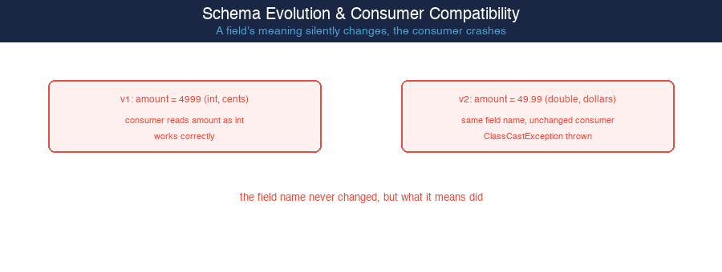
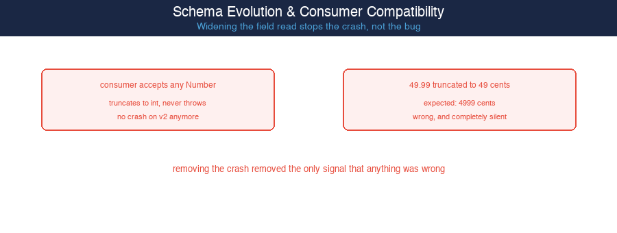
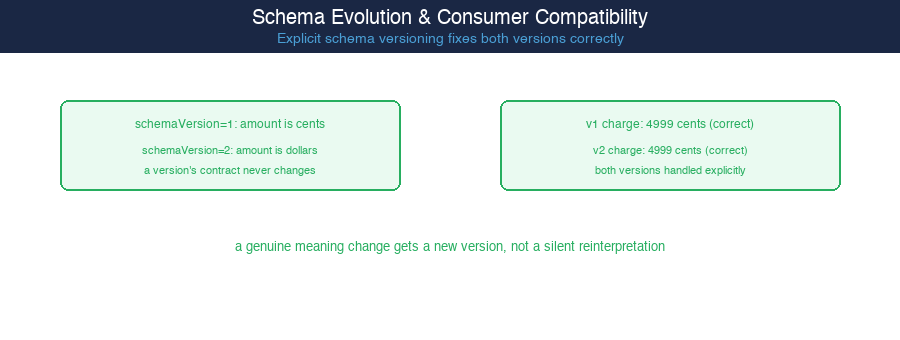

# Schema Evolution & Consumer Compatibility — A Field's Meaning Can Break Silently When Its Name Doesn't

**Pattern:** Producer silently changes a field's meaning, unchanged field name (a payment event's "amount" changes from integer cents to decimal dollars; an unversioned consumer with a fixed-type read crashes with a `ClassCastException`) → widening the field read to accept any Number (stops the crash, but silently truncates 49.99 dollars into 49 cents — a charge 100x too small, with no error at all) → explicit schema versioning (a `schemaVersion` field lets the consumer interpret "amount" according to that version's known contract, correctly handling both integer-cents and decimal-dollars events)

**Volume 24** (Event-Driven Architecture Patterns) — Paper 131.

---

## Read the Full Article on Medium

_Article coming soon on Medium._

---

## What This Paper Is About

An event schema's real contract isn't just which field names exist — it's what each field name actually means: its unit, its scale, its encoding. A producer that repurposes an existing field name to mean something new, without changing the name or signaling the change, breaks every consumer built against the old meaning, even though nothing about the field's presence or general type looks different (verified: a fixed-type read throws `ClassCastException` the moment "amount" switches from `Integer` cents to `Double` dollars). Widening the consumer's field read to tolerate the new type looks like a fix and does stop the crash, but it has no idea the unit itself changed, so it silently computes a charge 100 times too small with no error, log, or signal of any kind (verified: 49.99 dollars truncated to 49, treated as 49 cents instead of 4999). The actual fix stamps every event with an explicit `schemaVersion` and gives each version a fixed, never-changing contract for what its fields mean — the consumer reads the version first and interprets accordingly, handling both the cents-based and dollars-based event correctly (verified: both schema versions charge the correct 4999 cents).

## The Pressure: A Field's Meaning Silently Changes, the Consumer Crashes

A field's name staying the same gives no guarantee that what it represents stayed the same. A producer migration that changes a field's unit or encoding, without renaming the field, is invisible to any consumer code that only checks the field's presence and general type — the mismatch only surfaces once the consumer actually tries to use the value as if it still meant what it used to mean.

## The Principle

**A schema version's contract, once published, has to be immutable — a genuine change to what a field means requires a new version, not a silent reinterpretation of an old one.** The crash in the naive design isn't the real problem; it's actually the best-case outcome, because it's loud and immediate. The "fix" that widens the type check to stop the crash makes things worse, not better, because it removes the only signal a mismatch ever produced without addressing the mismatch itself. The only design that handles a genuine meaning change correctly is one where the consumer is explicitly told which version — and therefore which contract — it's looking at, before it interprets anything.

## Pros

- Makes an implicit assumption ("amount is always cents") into an explicit, checkable fact every consumer reads before interpreting anything else
- Lets a producer make a genuine breaking change (a real unit or encoding change) without ever breaking an existing consumer's already-deployed code
- Fails loudly and specifically on a version the consumer has never seen, rather than guessing or silently misinterpreting

## Cons

- Every consumer now has to carry a branch per schema version it supports, and that branch count only grows as more versions are published
- Requires producer-side discipline to actually stamp every event with the correct version and never repurpose an existing version's field meanings
- Doesn't eliminate the need to eventually retire old schema versions; supporting every version ever published indefinitely still accumulates complexity over time

## When an Unversioned Schema Is Still Acceptable

- A single team owns both the producer and every consumer, and both are deployed together as one atomic release — there's no compatibility gap to cross
- The event schema is genuinely closed with no realistic future need to change a field's meaning (e.g. a heartbeat with just a timestamp)
- The event is entirely internal to a single process and never serialized across a deploy boundary, so producer and consumer code can never be running two different versions at once

## Code Examples in This Repo

| Example | Domain | What It Shows |
|---------|--------|--------------|
| [`pressure`](./pressure) | Fixed-type field read, no versioning | Producer changes "amount" from int cents to double dollars; consumer's fixed-type read throws `ClassCastException` |
| [`wrong-direction`](./wrong-direction) | Widened Number field read, no versioning | Stops the crash, but silently truncates 49.99 dollars to 49 cents — a charge 100x too small, no error at all |
| [`principle-applied`](./principle-applied) | Explicit schemaVersion field | Consumer reads schemaVersion first and interprets "amount" per that version's fixed contract — both cents-based and dollars-based events charge correctly |

## Diagrams

